# 结构感知的量子启发优化算法-结项报告

## 1 项目信息

**项目名称：**结构感知的量子启发优化算法

**项目编号：**25c6d0296

**导师：**胡家祺

**项目链接：**https://summer-ospp.ac.cn/org/prodetail/25c6d0296?list=org&navpage=org

**项目周期：**2025-07-01~2025-09-30

**项目背景：**量子启发算法求解组合优化问题时，可以利用问题结构作算法改进，包括但不限于对称性、分岔点位置等，如何发掘利用这些结构来改进量子启发优化算法是具有应用价值的有趣问题。

**项目目标：**

1. 对于~1000节点的Ising/HUBO问题族，1小时内完成全部对称性计算，利用对称性改进量子启发算法，TTS（Time to Solution）相比朴素方法减少1倍以上；
2. 对于1中的Ising/HUBO问题，1小时内完成前五个分岔点及分岔图计算，实现可视化功能；
3. 提交规范的技术报告，需包含文献调研、算法原理、实验结果等部分；
4. 相关评估指标符合要求，代码需要有适当的注释并通过clean code标准
5. 最终项目代码需要通过审核并合入MindSpore Quantum代码仓。

**时间规划：**

2025.7.1~2025.8.15 完成项目目标1，对称性相关开发

2025.8.16~2025.9.15 完成项目目标2，分岔点相关开发

2025.9.16~2025.9.30 完成项目目标3,4,5，提交规范技术报告，完成指标评估与满足要求的代码撰写，并提交审核，合入MindSpore Quantum代码仓。

## 2 项目目标完成情况

| 序号 | 项目验收标准  （与项目目验收保持一致，可拷贝原文）           | 实际达成指标  （对照项目验收标准，一一给出实际达成的指标)    | 交付件  （输出结果图或文档，如与目标有差异，请说明情况）     | 是否满足验收标准 |
| ---- | ------------------------------------------------------------ | ------------------------------------------------------------ | ------------------------------------------------------------ | ---------------- |
| 1    | 1. 对于~1000节点的Ising/HUBO问题族，1小时内完成全部对称性计算，利用对称性改进量子启发算法，TTS（Time to Solution）相比朴素方法减少1倍以上； | 1. 对于~1000节点的Ising/HUBO问题族，满足1小时内完成全部对称性计算，利用对称性改进量子启发算法，满足TTS（Time to Solution）相比朴素方法减少1倍以上； | 详见结项报告1.5                                              | 满足             |
| 2    | 2. 对于1中的Ising/HUBO问题，1小时内完成前五个分岔点及分岔图计算，实现可视化功能； | 2. 对于1中的Ising/HUBO问题，满足1小时内完成前五个分岔点及分岔图计算，并编程实现可视化功能； | 详见结项报告1.6                                              | 满足             |
| 3    | 3. 提交规范的技术报告，需包含文献调研、算法原理、实验结果等部分； | 3. 已提交规范的技术报告，且满足包含文献调研、算法原理、实验结果等部分； | 文献调研见结项报告1.3  算法原理见结项报告1.4  实验结果见结项报告1.5.3与1.6.3 | 满足             |
| 4    | 4. 相关评估指标符合要求，代码需要有适当的注释并通过clean code标准 | 4. 相关评估指标符合要求，代码有适当的注释，通过clean code标准 | 代码符合要求，见mindquantum代码仓2025开源之夏mindquantum/summer_ospp/2025/25c6d0296 | 满足             |
| 5    | 5. 最终项目代码需要通过审核并合入MindSpore Quantum代码仓。   | 5. 最终项目代码已通过审核并合入MindSpore Quantum代码仓。     | 见mindquantum代码仓2025开源之夏mindquantum/summer_ospp/2025/25c6d0296 | 满足             |

## 3 文献调研

在对复杂物理系统的研究中，一个有效的研究策略是从分析一个简化的、但具有代表性的模型入手。Z2格点规范理论便是其中最基础的模型之一，它为研究具有局域对称性的物理系统提供了一个可控的理论框架 [1, 2]。该模型虽然定义在简单的格点结构上，但其动态行为受到一个被称为“高斯定律”的局域对称性约束，这一约束必须在格点的每个位置都得到满足，从而给模型的直接求解带来了挑战。

“对偶性”（Duality）是分析此类约束系统的强大理论工具。一个对偶变换可以将一个物理理论映射到另一个不同的理论，后者往往能为同一物理现象提供一个更简洁、更易于处理的描述。该思想的经典范例是伊辛模型的 Kramers-Wannier 对偶，它揭示了该模型内在的深刻对称性 [3]。

在此基础上，Wegner 的工作进一步将对偶性的思想推广，并证明了 (2+1) 维的 Z2格点规范理论与量子伊辛模型之间存在一个精确的对偶关系 [4]。这种“规范-自旋对偶性”的根本价值在于，它能够将原始理论中固有的局域规范约束消除，从而得到一个仅受全局对称性支配的等效自旋模型。这一简化不仅为解析和数值研究提供了便利，也为理解禁闭等物理现象提供了理论洞见 [5, 6]，并对量子模拟等前沿研究领域具有重要的启发意义。

分叉点求解方面，为系统性求解非线性方程组并追踪其解路径，数值延拓方法提供了坚实的理论与算法框架。该方法将目标问题嵌入到一个参数化的方程族中，通过追踪解在该参数化空间中形成的流形来获得最终解。这一领域的基础理论，包括“预测-校正”机制、弧长参数化和步长自适应控制等关键技术，在多部权威专著中都有全面而深入的阐述 [8]。

在处理复杂的非线性问题时，解路径常常会出现使得特定参数化失效的奇点，例如“回头点”。为了克服此难题，研究人员提出了利用弧长作为延拓参数来构建增广系统的关键技术，从而能够稳健地追踪解路径穿过这些奇点。在此基础上，后续研究进一步发展了用于精确计算和定位回头点的高效数值算法，提升了方法的精度与可靠性 [9]。

这些路径追踪算法是进行分岔分析的核心工具。通过延拓方法，不仅可以追踪解分支，还能探测和定位路径上的分岔点，并进行分支切换以探索新的解。对于各种静态与动态分岔点的系统分类、稳定性分析以及在实际科学工程问题中的应用，已有大量文献进行了深入探讨 [10]。这些工作为理解非线性系统的动态行为、绘制完整的分岔图以及揭示复杂现象的内在机理提供了成熟的理论指导和强大的数值计算支持[11]。

**参考文献**
[1] Wilson, K. G. Confinement of quarks. Physical Review D 10, 2445–2459 (1974). doi:10.1103/PhysRevD.10.2445.
[2] Kogut, J. B. An introduction to lattice gauge theory and spin systems. Reviews of Modern Physics 51, 659–713 (1979). doi:10.1103/RevModPhys.51.659.
[3] Kramers, H. A. & Wannier, G. H. Statistics of the Two-Dimensional Ferromagnet. Part I. Physical Review 60, 252–262 (1941). doi:10.1103/PhysRev.60.252.
[4] Wegner, F. J. Duality in Generalized Ising Models and Phase Transitions without Local Order Parameters. Journal of Mathematical Physics 12, 2259–2272 (1971). doi:10.1063/1.1665530.
[5] 't Hooft, G. On the phase transition towards permanent quark confinement. Nuclear Physics B 138, 1–25 (1978). doi:10.1016/0550-3213(78)90153-0.
[6] Savit, R. Duality in field theory and statistical systems. Reviews of Modern Physics 52, 453–487 (1980). doi:10.1103/RevModPhys.52.453.
[7] Zohar, E., Cirac, J. I. & Reznik, B. Quantum simulations of lattice gauge theories using ultracold atoms in optical lattices. Reports on Progress in Physics 79, 014401 (2015). doi:10.1088/0034-4885/79/1/014401.
[8] Allgower, E. L. & Georg, K. Introduction to Numerical Continuation Methods. (Society for Industrial and Applied Mathematics, 2003). doi:10.1137/1.9780898719154.
[9] Broeckhove, J., Kłosiewicz, P. & Vanroose, W. Applying numerical continuation to the parameter dependence of solutions of the Schrödinger equation. Journal of Computational and Applied Mathematics 234, 1238–1248 (2010).
[10] Uecker, H. Continuation and Bifurcation in Nonlinear PDEs – Algorithms, Applications, and Experiments. Jahresber. Dtsch. Math. Ver. 124, 43–80 (2022).
[11] Uecker, H. Numerical Continuation and Bifurcation in Nonlinear PDEs. (2021). doi:10.1137/1.9781611976618.

## 4 算法原理

### 4.1 Z2格点规范理论与对偶变换

该研究中高阶优化问题的结构源于Z2格点规范理论。系统的哈密顿量由下式定义，其包含了与格点边相关的电场项和与格点面相关的磁场项 。其中，磁场项表现为环绕每个面的四个Z2变量的乘积，构成了四阶相互作用的形式：

​                               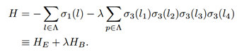

此理论内含一个关键的局域规范不变性，表现为高斯定律约束，见下式。该约束定义了物理希尔伯特空间，要求在任意格点处，相关算符的乘积为单位算符，从而剔除了系统中的非物理自由度。

 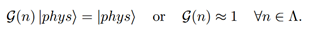

为了获得一个无约束的等效模型，可采用一系列正则变换。此过程将初始的共轭算符分解为物理性的圈算符和非物理性的弦算符。在高斯定律的作用下，非物理的弦算符在物理子空间内被冻结，并与系统解耦：

 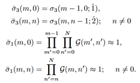

最终，该变换将原始的规范理论哈密顿量精确映射为一个对偶的Z2自旋模型哈密顿量，如下式所示 。此对偶模型不存在局域约束，且有效降低了变量的个数与问题的阶数，简化了问题。

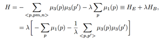

### 4.2 基于弧长延拓的同伦方法

对于一个目标非线性方程组 F(x)=0，直接求解可能非常困难。同伦法的策略是构造一个更简单、具有已知解 的系统。随后，定义一个同伦映射H

 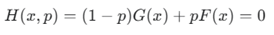

这里，p是同伦参数。当p=0时，方程解已知。当 p=1 时，方程解即为原始问题的目标解。

随着参数 p 从0到1连续变化，方程的解在空间中形成一条连续的解路径。直接以 p 为步进参数进行追踪，在路径发生转折或分岔时会失效。为了克服此问题，算法采用弧长延拓法。该方法引入弧长s作为新的路径参数，并将x,p均视为 s 的函数。

追踪过程中，首先计算预测步：在当前解路径上的点，算法首先计算出路径前进的切线方向。该方向由同伦方程对弧长 s 的全导数确定：

 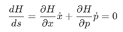

结合归一化约束，可以解出单位切向量。随后，算法沿着此方向前进一小步得到下一个点的初步预测值  。

为确保追踪的精确性，算法会先通过求解一个增广的非线性方程组，使计算点回归至真实的解路径。该方程组包括原始的同伦方程和一个约束校正方向与预测方向垂直的方程：

 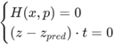

与此同时，算法持续对路径的稳定性进行诊断，以预见并处理可能出现的分岔。当监测到路径出现分支的迹象时，算法会通过二分法定位该临界点，并在此基础上基于奇异值分解（SVD）等方法计算零空间。接着，算法会在该分岔点启动多个新的追踪任务，每个任务负责沿一条新路径进行探索。最终实现高效的分岔点识别。

## 5 对称性计算与算法改进

### 需求分析

于~1000节点的Ising/HUBO问题族，1小时内完成全部对称性计算，利用对称性改进量子启发算法，TTS（Time to Solution）相比朴素方法减少1倍以上，该需求可分为两个部分：

① 设计算法完成全部对称性计算，算法效率需满足时间限制。

② 利用对称性改进量子启发算法，并实现1倍的TTS改进。

### 研究方案、技术路线

 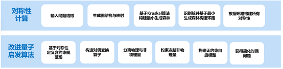

本研究面向需求，对节点规模在千量级的Ising/HUBO问题，开发一套集成的对称性分析与算法优化框架。核心研究内容包括高效的对称性计算与基于对称性的量子启发算法改进两个方面：

首先，我们计划设计并实现一种高效的对称性发现算法。该算法通过将问题实例映射为图结构，利用基于Kruskal算法构建的最小生成森林来识别图的基本环路，并以此为基础构造出问题的全部对称性。此算法的设计目标是确保对于约1000个节点的复杂问题，整体计算流程能在一小时内完成，满足大规模问题求解的效率要求。

在获得问题的对称性后，我们将利用这些对称性来从根本上改进量子启发算法的性能。具体而言，我们将基于对称性定义一个含约束的规范场，构造对偶变换算子，从而有效分离并“冻结”问题中的非物理（冗余）自由度。通过此方法，原始的复杂问题将被约简为一个规模更小、无约束的等效HUBO模型。

通过上述对称性约简技术，简化问题的求解空间，我们预期可以使改进后的量子启发算法在求解时间（TTS）上，相比于不利用对称性的朴素方法，实现至少一倍的性能提升（即求解时间减半），从而显著加速大规模组合优化问题的求解。

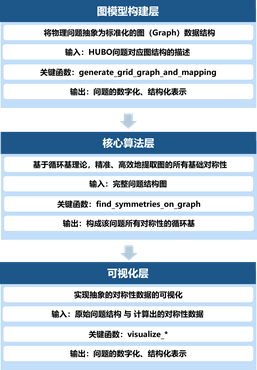

为了高效地完成大规模HUBO问题的对称性计算任务，我们设计并实现了一套系统化的解决方案。该方案遵循模块化思想，将整个计算流程划分为图模型构建、核心算法和可视化三个层次，如图所示。

图模型构建层：此为数据预处理阶段。我们将物理或数学上的HUBO问题抽象为标准的图数据结构。通过关键函数 generate_grid_graph_and_mapping，我们将问题的拓扑描述转化为数字化的邻接关系和变量映射，为后续的算法分析提供结构化、标准化的输入。

核心算法层：这是整个方案的计算核心。基于图论中的循环基理论，我们通过 find_symmetries_on_graph 函数对构建好的图模型进行分析。该算法能够精准、高效地提取出构成问题所有基础对称性的循环基，这些循环基即为问题的对称性解。算法的效率是满足项目性能要求的关键。

可视化层：为了直观地理解和验证计算出的对称性结果，本层负责将抽象的对称性数据进行图形化展示。利用 visualize_* 系列函数，我们将原始问题图结构与计算出的对称性循环基相结合，生成清晰的对称性可视化图像，极大地增强了结果的可解释性。

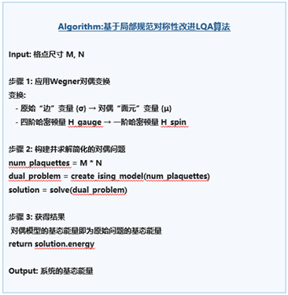

我们提出并实现了一种基于局部规范对称性的改进算法。该方法的核心思想并非直接求解原有的复杂高阶问题，而是利用 Wegner 对偶变换，将问题映射到一个更易于求解的对偶空间中，从而实现计算加速。

首先，我们应用 Wegner 对偶变换，此步骤是算法的核心。我们利用问题内在的规范对称性，将描述系统的变量从原来的边变量σ变换为面元变量μ。这一变换的关键优势在于它极大地简化了问题的哈密顿量：原有的、包含四体相互作用的复杂四阶哈密顿量（H_gauge）被精确地映射为一个仅含单体项的一阶哈密顿量（H_spin）。这从根本上降低了问题的计算复杂度。

接下来，求解对偶问题并获得结果。变换之后，原问题转化为了一个标准的、简化的Ising模型。我们为这个对偶问题构建计算模型，并调用高效的求解器（如量子启发算法）进行求解。得益于对偶变换的优美特性，对偶模型的基态能量与原始问题的基态能量完全相等。因此，我们只需返回求解得到的对偶问题能量 solution.energy，即可获得原始复杂问题的精确解。

通过这一“变换-求解-映射”的策略，我们成功规避了直接处理高阶相互作用的巨大计算开销，转而在一个结构更简单、计算更高效的对偶空间中完成任务，最终以更短的时间获得问题的解，从而显著降低了TTS，达到了项目的性能要求。

### 实验结果

#### 对称性计算引擎

树结构构建示意图（包含32*32网格状结构和1100节点Voronoi图结构）：

图1：基于32*32网格状结构的树结构构建示意图

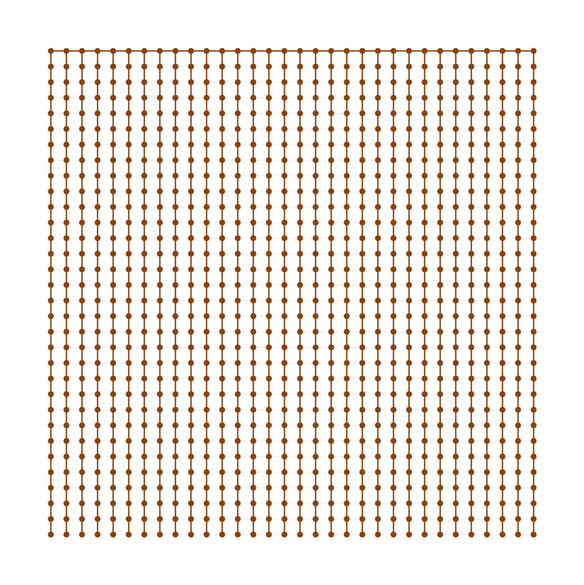

图2：基于1100节点Voronoi图结构的树结构构建示意图，图中离散点为胞腔母点

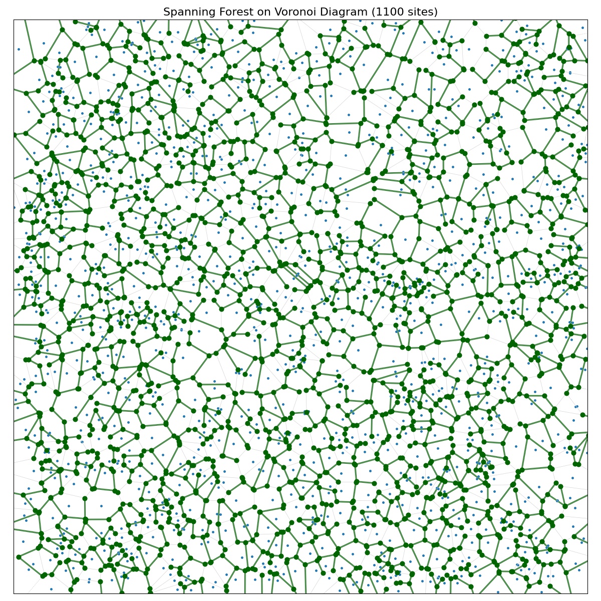

部分局部对称性图结构（32*32网格结构与1100节点Voronoi图结构）：

图3：基于32*32网格状结构的部分局部对称性图结构

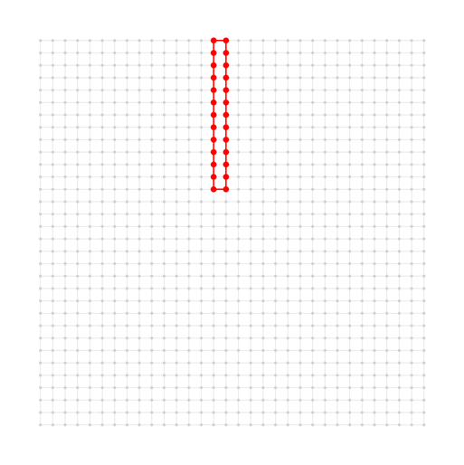

图4：基于1100节点Voronoi图结构的部分局部对称性图结构（图中蓝色点为胞腔母点）

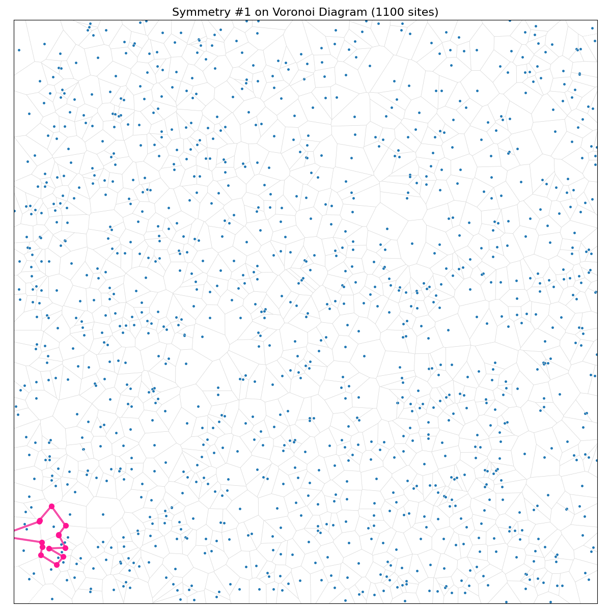

图5：所有对称性结构示意图（25*25网格）

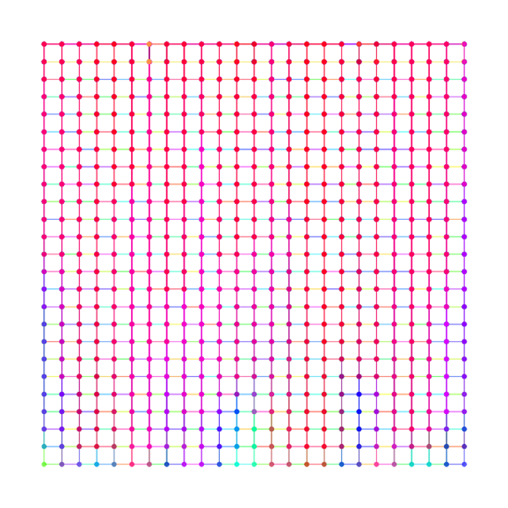

图6：所有对称性结构示意图（32*32网格）：

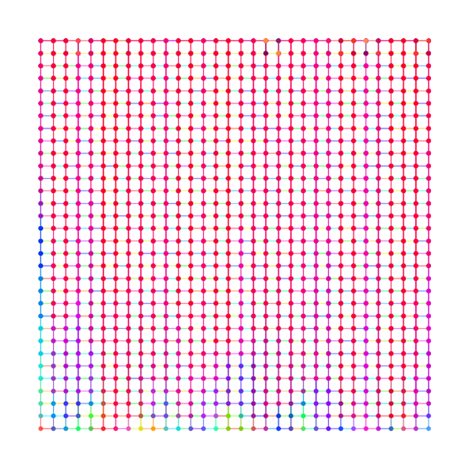

图7：所有对称性结构示意图（1100节点Voronoi图，图中蓝色点为胞腔母点）：

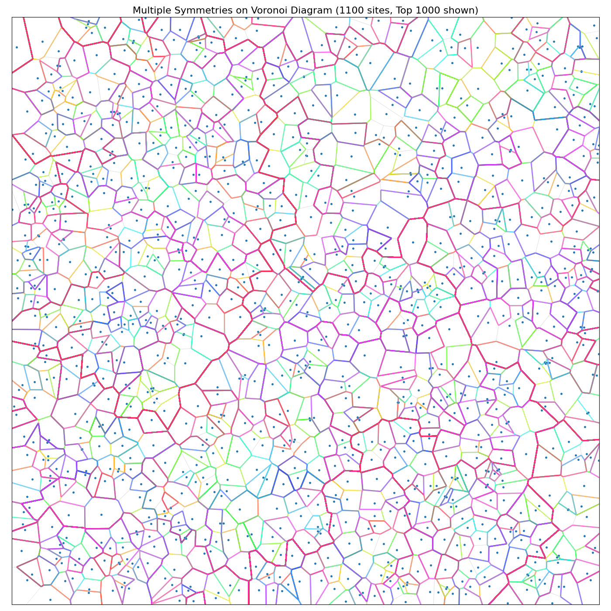

图8：对称性识别时间随问题规模的变化（网格状结构）：

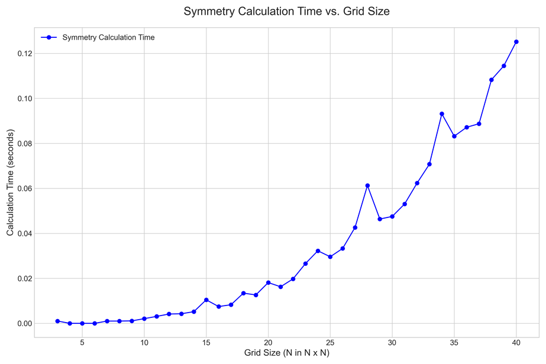

图9：对称性识别时间随问题规模的变化（Voronoi图）：

不管是网格状结构还是Voronoi图，对称性识别时间随问题规模变化，对于大于1000节点的HUBO问题（N>=32），均能在时间限制（1h）内完成计算，且求解时间小于1s，显示了可靠的性能。满足 “1小时内完成全部对称性计算”的需求。

#### 基于局部规范对称性改进LQA算法

图10：基于对称性改进后的LQA与LQA的求解时间随问题规模的变化（网格状图）:

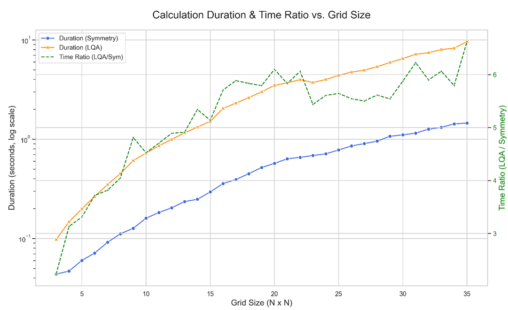

图11：基于对称性改进和LQA的求解时间随问题规模的变化（Voronoi图）:

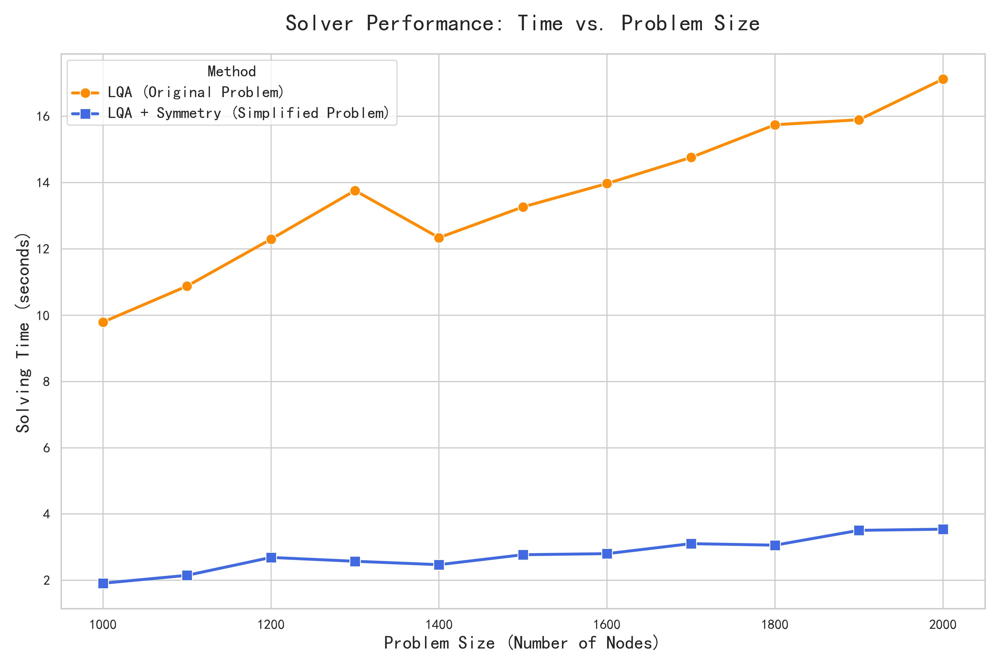

上图显示了基于对称性改进后的LQA算法与LQA相比在求解时间方面展现的优势。首先，改进后的方法与LQA相比，在网格状图和Voronoi图上均至少展示了3倍的求解效率提升，此外，随着问题规模增大，改进后的方法的加速逐渐增加，这是改进算法有效降低阶数和变量数带来的。展现了基于对称性改进的LQA算法在解决更大规模问题上的潜力。

图12：基于对称性改进后的LQA与LQA的解能量随问题规模的变化对比（网格状图）

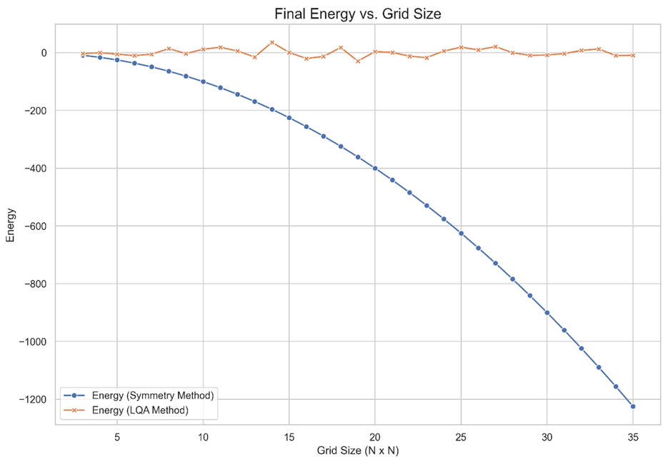

图13：基于对称性改进后的LQA与LQA的解能量随问题规模的变化对比（Voronoi图）

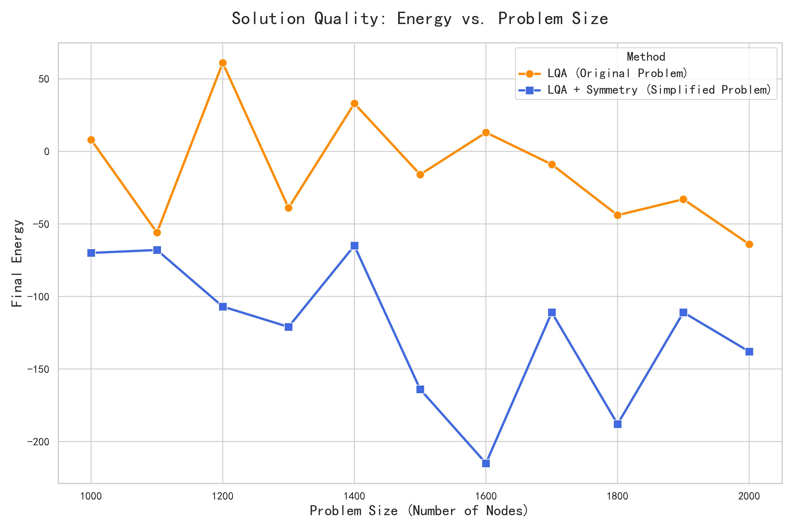

与LQA相比，在网格状图和Voronoi图上，基于对称性改进的LQA算法的求解能量均小于LQA，且随问题规模增加更具优势。综上所述，基于对称性改进的LQA算法在求解速度和求解质量方面都实现了可观的提升，且满足项目要求。

## 6 分岔点计算与分岔图绘制

### 6.1 需求分析

对于1中的Ising/HUBO问题，1小时内完成前五个分岔点及分岔图计算，实现可视化功能；

① 设计高效算法计算前五个分岔点，在1小时内完成计算。

② 实现可视化功能。

### 6.2 研究方案、技术路线

分岔点计算与分岔图绘制研究方案示意图：

本研究旨在面向大规模组合优化问题，开发一套集同伦延拓求解与分岔分析于一体的创新框架。核心内容包括构建一个能够遍历关键路径的高性能求解器以及多维度可视化工具集。

在分岔点计算方面，我们将构建一个参数化的同伦问题，并采用弧长延拓法追踪其从简单到复杂的完整解路径。当路径行进至关键的分岔点时，算法能够识别并派生出新的求解器，沿着所有新萌生的路径分支进行并行探索。该过程循环直至所有路径探索完毕，从而系统性地捕获问题的全局解结构。

在可视化功能方面，为直观揭示解空间的复杂结构，我们计划开发一套多维度分析工具。内容包括：绘制标准分岔图与能量演化图，用于展现解的演化轨迹与质量；以及基于PCA降维的路径演化图，通过弧长与同伦参数两种着色方案，从不同维度呈现高维空间的探索全貌。通过上述框架，我们预期不仅能获得问题的一系列高质量候选解，更希望揭示问题解空间的全局拓扑结构与能量景观，进一步促进理解问题的内在机制，开发更优算法。

### 6.3 实验结果

图14：分岔点/分岔图计算中变量x0随演化变化趋势（32x32HUBO问题）：

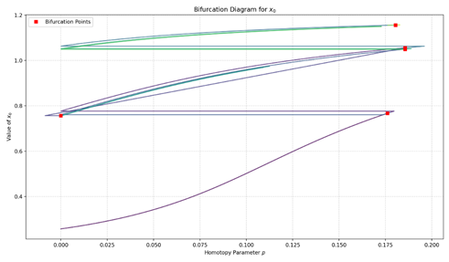

上图展示了同伦演化过程中，解向量的特定分量$x_0$ 随参数 p 的变化轨迹。分析该图可以得出以下几点结论：首先，图中标注出的分岔点出现在演化的不同阶段，尤其是在 p≈0.18 附近存在一个集中区域。这些临界表示问题解空间的结构在此处发生了显著变化，可能伴随着新解路径的产生或解稳定性的改变。其次，  路径展现出向   附近收敛的趋势。对于所研究的优化问题，其有效解的各分量理论值应趋于+1或-1，因此这一现象表明所追踪的路径正在向具有物理意义的高质量解区域演化。最后，图中路径呈现出复杂的非单调行为，包含多个折返点。算法能够平滑地追踪这些包含折返的完整路径，证明了所采用的弧长延拓方法在处理此类复杂路径行为时的有效性和鲁棒性，确保了对解空间更全面的探索。

图15：分岔点/分岔图计算中解的能量随演化变化趋势（32x32HUBO问题）:

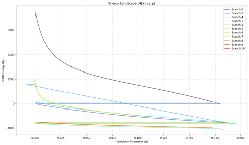

上图反映了在32x32规模HUBO问题中，不同解分支的能量 H(x) 随同伦参数 p 的演化过程。从图中可见，所有分支的能量均随 p 的增大呈现下降趋势，这与同伦方法引导系统从初始状态松弛至目标问题低能解的设计相符。在演化过程中，解路径在能量上出现了显著分化。结合分支索引（Branch Index）的生成次序，可以观察到算法通过分岔过程，逐步发现了能量更低的解路径。初始分支（如Branch 0）的能量相对较高，但随着演化的进行，在其路径上或后续分支上产生的新分支（具有更大索引号），展现出进入更低能级区域的能力。这表明，分岔点不仅是路径的结构变化点，可能能够通往更优解空间。

图16：搜索过程随同伦参数p变化的PCA图（32x32HUBO问题）：

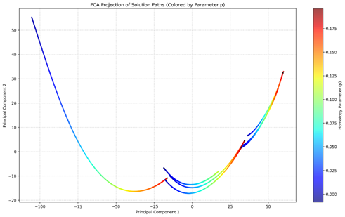

图17：搜索过程随弧长s变化的PCA图（32x32HUBO问题）：

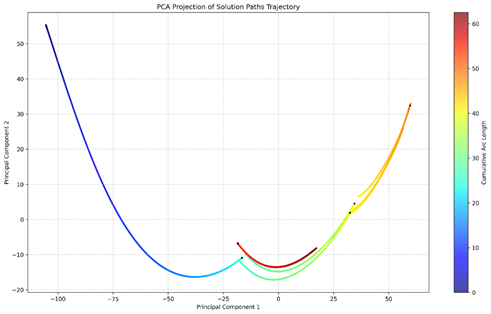

以上2图分别从不同维度展示了在32x32规模HUBO问题中，算法搜索到的高维解路径经过主成分分析（PCA）降维后的二维投影。第一张图展示了以同伦参数 p 作为着色依据的路径演化，第二张图展示了以弧长s作为着色依据的路径演化。注意到，每条路径的形状均接近于U形，其中，主成分1持续增大，而主成分2呈现先减小后增大的趋势。整体上看，所有路径的形状同样接近U形，这或许意味着在U形曲线的上方，存在较高的能量景观，同伦延拓的过程就是在尝试绕过该景观，并进一步让能量下降的过程。这为进一步分析HUBO问题的问题特性给出了有意思的观察。

图18：整体搜索时间随求解规模变化图：

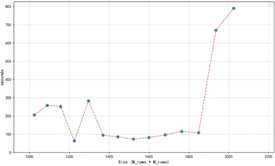

上图展示了在大于1000个节点的HUBO问题上，分叉点求解时间随求解规模的变化示意图，可见即使超过2000节点，算法也能够在时间要求（1h）内完成所有求解。证明了算法的高效性.

综上所述，算法满足“1小时内完成前五个分岔点及分岔图计算，实现可视化功能”的项目需求。

