# 顾昀-25c6d0301-结项报告

## 一、项目信息

- **项目名称**：基于 MindSpore Quantum 实现薛定谔-海森堡变分算法  
- **方案描述**：
  
  1. **Fig2**: entanglement entropy Delta_t = Haar Measurement 模拟的均匀分布的态的熵 - SH-VQA/VQA 生成的量子态的熵，在代码中我尝试了多种不同的 Schrodinger 电路设计（强纠缠型和硬件有效型）。
  
  2. **Fig3**: 
     - 使用量子神经网络优化：1. Clifford 电路的设计构型（也使用参数表示）2. Clifford电路的参数 3. Schrodinger电路的参数。求解XXZ model的特例。找出求解XXZ model的特例最优的Clifford 电路的设计构型（全连接型）
     - 比较了不同Clifford电路构型下SH-VQA求解XXZ model的解与数值解 Fedility的不同。（使用全连接构型时 Fedility最高）
     - 全连接的Clifford电路使得SH-VQA在处理XXZ model特例的求解上性能远好于VQA，通过一系列使用SH-VQA/VQA的不同qubit数，不同depth的电路求解的结果的Fedility表示。
- **时间规划**：  
  - **7 月**：完成环境搭建、文献阅读、算法框架理解与初步代码实现（含 HT 变换与 Clifford 电路生成的基础模块）。  
  - **8 月**：开展 Fig2 的完整复现，包括 Haar 基准态生成、Δt 指标实现与曲线绘制；在不同深度和参数范围下进行稳定性实验并整理结果。  
  - **9 月**：开展 Fig3 的复现与拓展，包括在 XXZ Hamiltonian 上实现 SH-VQA 优化循环，对比不同 Clifford 结构（全连接、局域耦合等）的收敛效果，最终输出能量/保真度曲线与总结。  
 

---

## 二、项目总结

- **已完成工作**：  
  
  Fig2_a、Fig2_b、Fig3_bc、Fig3_d 复现已经分别完成。  
  
  实验环境：arch64；Intel(R) Core(TM) i7-10750H CPU @ 2.60GHz (2.59 GHz)。  
  
  系统环境请参考项目内 Dockerfile。

  复现内容参见 display.ipynb
  
  ### 对于Fig2—a,b的复现
  
  #### Fig2_a
  
  - **核心函数文件**: `Fig2/fig2a_functions.py`
    - `load_design()`: 加载spherical design数据
    - `plot_spherical_design()`: 绘制单个spherical design图形
    - `generate_all_figures()`: 生成所有图形
  
  数据：Fig2/data 原始点坐标数据直接来自 PolyU spherical design 仓库 [[link]](https://www.polyu.edu.hk/ama/staff/xjchen/sphdesigns.html)。

  复现结果:
  
  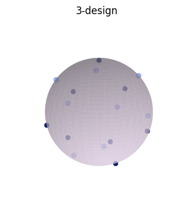
  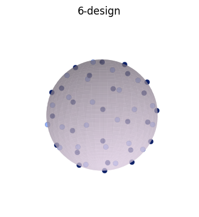
  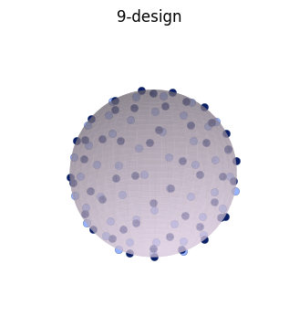
  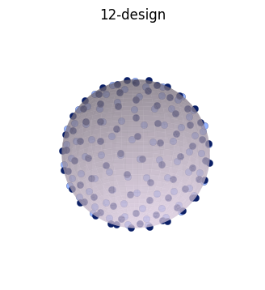
  
  论文中的原图:
  
  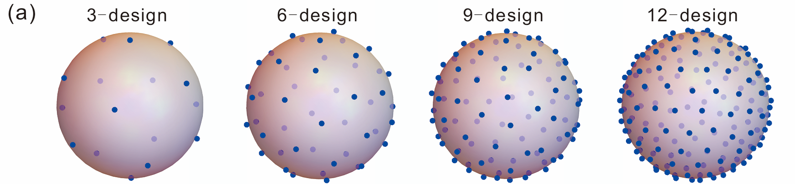
  
  #### Fig2_b
  
  - **核心函数文件**: `Fig2/fig2b_functions.py`
    - 电路构建函数（build_param_luc_ansatz, build_param_luc_ansatz_strong, build_hardware_efficient_luc等）
    - Haar采样和Ensemble采样函数
    - Δ_t计算函数
    - 可视化函数（compute_and_plot_delta_t）
    - 实验运行函数（run_fig2b_experiment）

  复现结果:
  
  硬件高效型 build_hardware_efficient_luc
  
  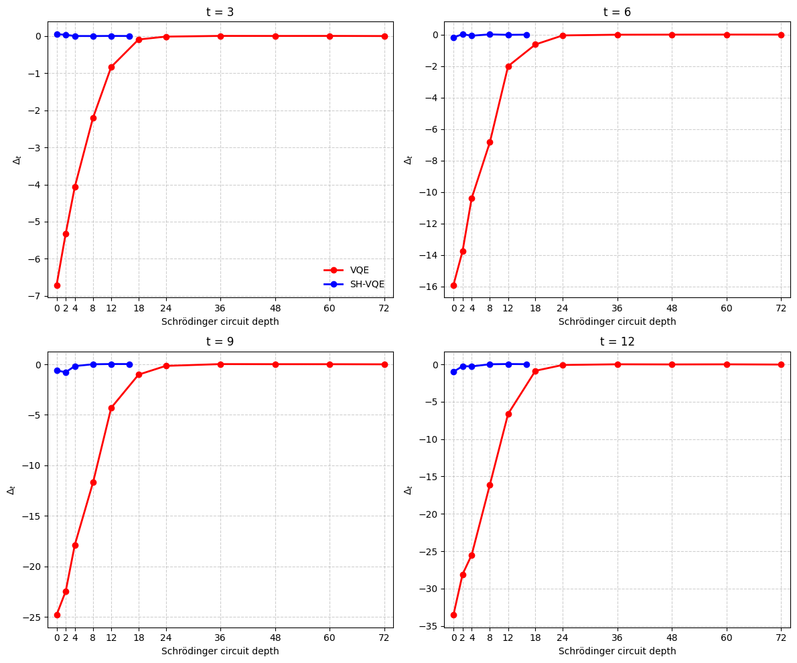
  
  增强型 build_param_luc_ansatz_strong
  
  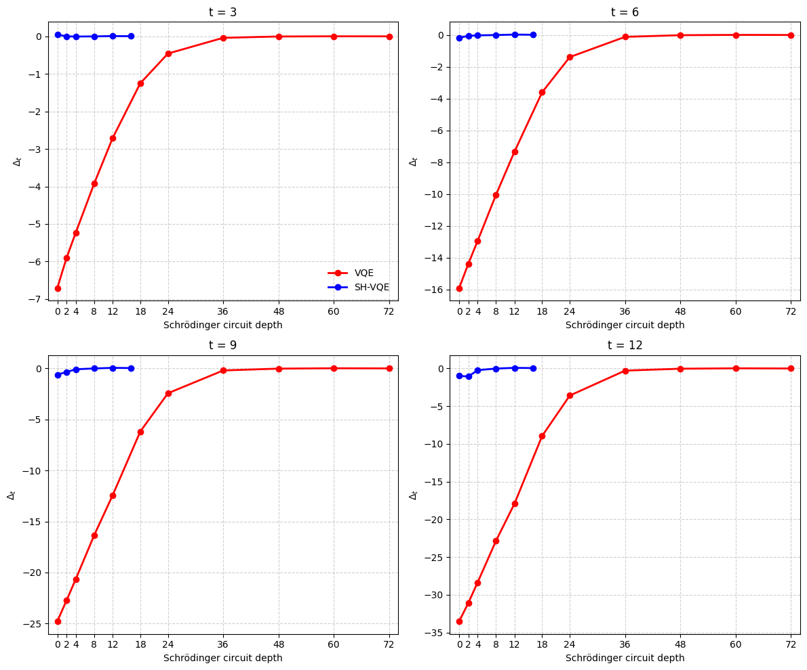
  
  基础型 build_param_luc_ansatz
  
  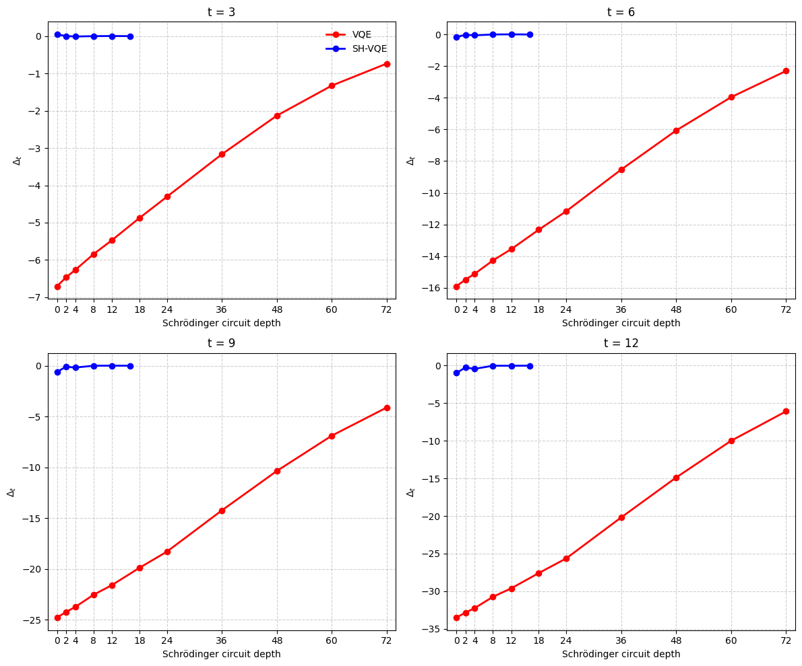
  
  论文中的原图:
  
  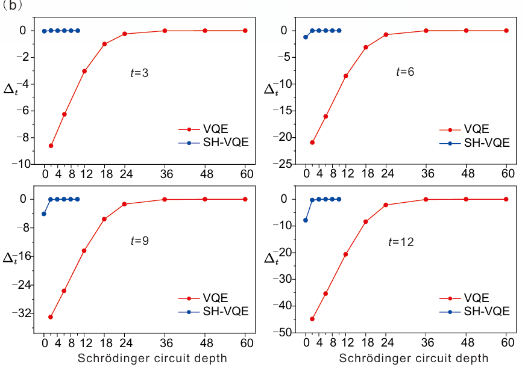
  
  ### 对于Fig3-bc，d的复现
  
  #### Fig3_bc
  
  - **核心函数文件**: `Fig3/fig3bc_functions.py`
    - Hamiltonian构建（hamiltonian_xxz）
    - Clifford电路构建
    - VQE和SH-VQE电路构建
    - 基态和Fidelity计算
    - 结构策略（GraphPolicy）
    - 交替训练函数（alternating_train_mq）
    - 可视化函数（plot_fig3b, plot_fig3c）

    复现结果:
  
    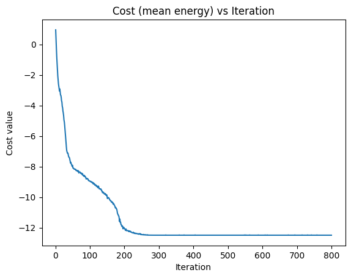
    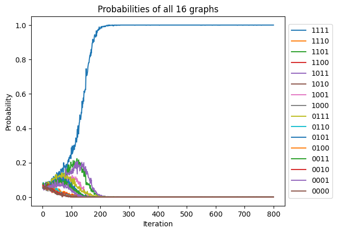
    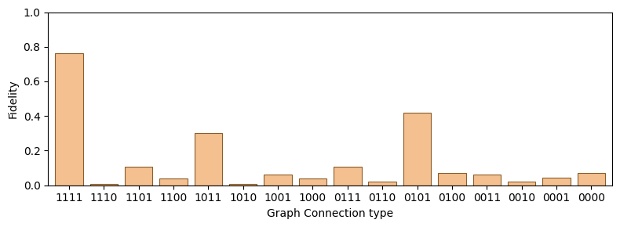
  
    论文中的原图:
  
    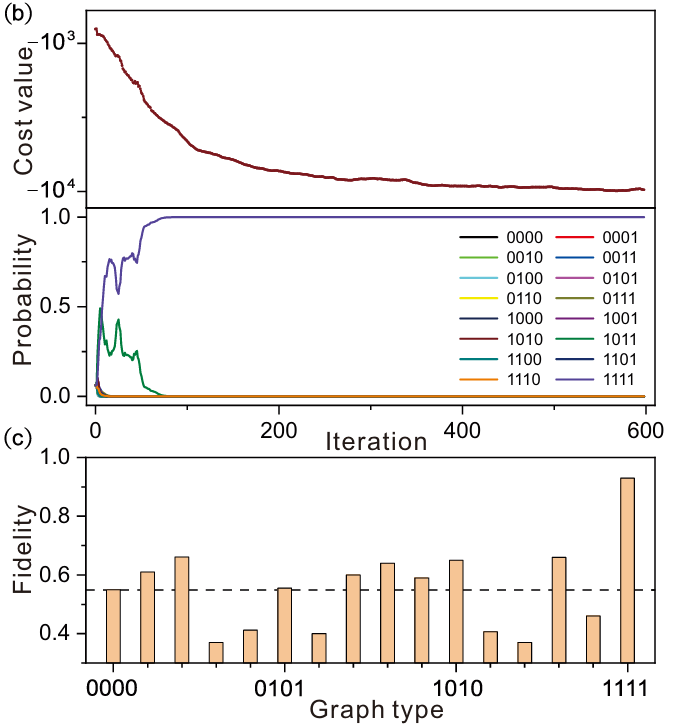
  
  #### Fig3_bc_another
  
  - **核心函数文件**: `Fig3/fig3bc_another_functions.py`
    - SPSA优化器（AdamOpt）
    - SPSA训练函数（train_with_empirical_log）
    - 可视化函数（plot_fig3b_spsa, plot_fig3c_from_results）

    复现结果:
  
    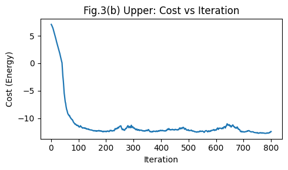
    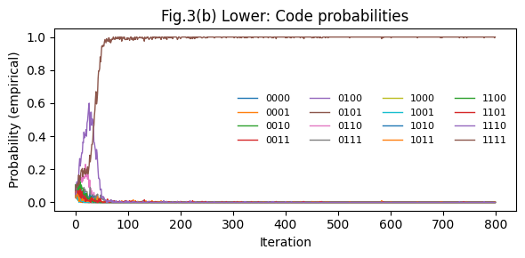
    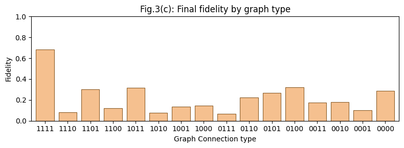
  
    论文中的原图:
  
    
  
  #### Fig3_d
  
  - **核心函数文件**: `Fig3/fig3d_functions.py`
    - VQE和SH-VQE电路构建
    - Adam训练函数（adam_train_energy_ansatz）
    - 实验运行函数（run_vqe_experiment, run_sh_vqe_experiment）
    - 可视化函数（plot_fig3d）

    复现结果:
  
    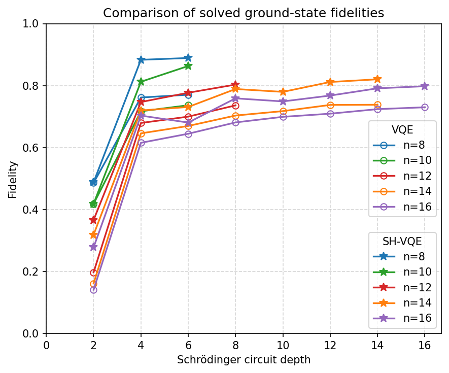
  
    论文中的原图:
  
    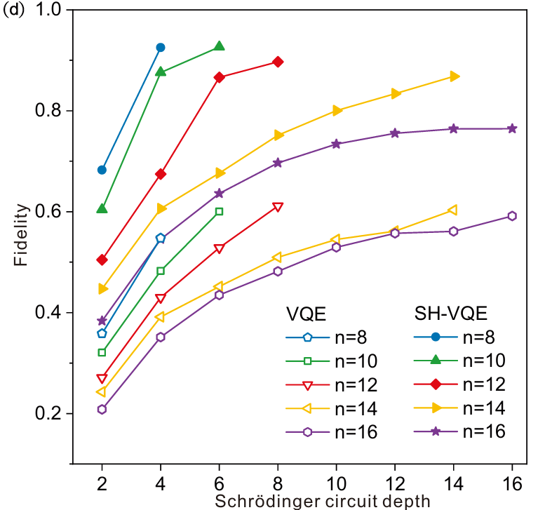

- **遇到的问题及解决方案（总结与心得）**：  
  
  1. **硬件高效的电路设计**：在 NISQ 条件下，应优先采用浅层、可并行、门数可控的电路结构。  
  
  2. **量子神经网络训练**：通过固定随机种子、调节学习率、shots 与方差平衡等方法提升训练稳定性，防止结果过度优化或者陷入局部最优。  
  
  3. **Clifford 电路的设计**：结合问题对称性约束缩小搜索空间，将 Clifford 结构作为虚拟深电路的等效变换来增强表达力。

---

## 三、后续工作安排

1. 测试在 XXZ model 之外，该方法是否同样适用于其他 Hamiltonian（如 TFIM、Heisenberg 或随机局域模型），评估其泛化能力与鲁棒性。
  
2. 能否使用GPU功能加速Fig3代码的训练过程。
