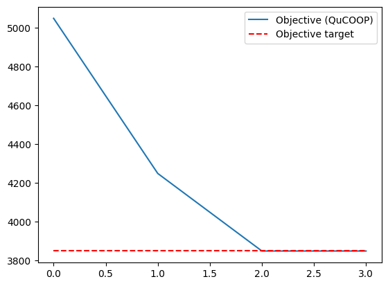
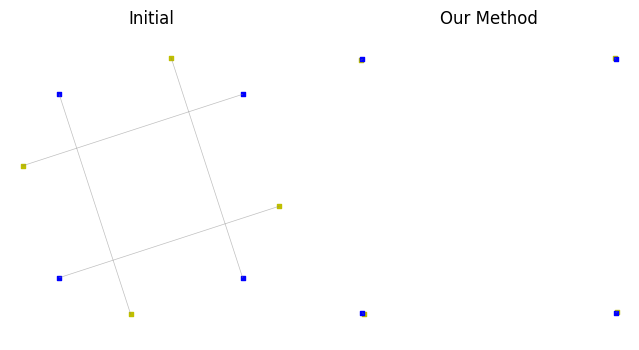
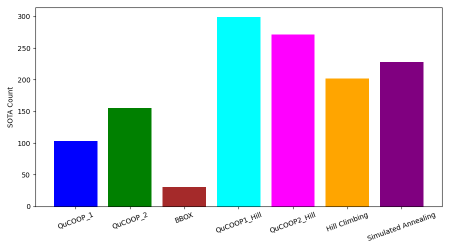

# 项目总结报告

---

## 项目名称  
**基于量子退火器的复合与二元参数优化问题求解框架**

---

## 一、问题描述  

### 1. 研究目标  

本项目的研究目标是设计一个通用框架，用于解决 **非 QUBO 的二元优化问题**。形式化描述如下：  

$$
f^\star = \min_{s \in S} f(s), \quad S \subseteq \{0,1\}^n,
$$  

其中 $S$ 表示所有可行解的集合，$f : \{0,1\}^n \to \mathbb{R}$ 是目标函数。 量子退火器（或量子近似优化算法QAOA）或者某些专用计算机（如Ising机）只能直接处理 QUBO (Quadratic Unconstrained Binary Optimization) 问题，其标准形式为：  

  $$
  \min_{z \in \{0,1\}^n} \; z^T Q z + c^T z + \text{const}, \quad Q \in \mathbb{R}^{n\times n}.
  $$  

在实际应用中，二元优化问题往往包含高阶项或复杂约束，使其难以直接转化为 QUBO 形式（non-QUBO）。如何在量子退火器或相关混合框架下高效求解此类问题，仍是一个尚未解决的开放研究方向。近期，ICLR 2025 接收的工作 “QuCOOP: A Versatile Framework for Solving Composite and Binary-Parametrised Problems on Quantum Annealers” (https://arxiv.org/pdf/2503.19718) 针对计算机视觉中的典型任务——例如二次分配问题（QAP）与点集配准问题——提出了 QuCOOP 框架。该方法利用目标函数的复合二次结构，通过局部线性化将原问题迭代近似为一系列 QUBO 子问题，并分别在经典模拟退火与量子退火硬件上进行优化实验，取得了具有竞争力的结果。然而，需要指出的是，该方法仍然依赖于特定的复合二次形式假设；对于更一般的含二元约束的连续优化问题，目前仍缺乏系统性的理论分析与实践探索。

因此，本项目提出针对更一般的含二元约束的连续函数的QuCOOP框架。本项目的的核心目标是：把任意的非 QUBO 二元优化问题转化为等价或近似的多个 QUBO 表达，从而能够被量子退火器或者量子近似优化算法（QAOA）高效求解。

---

## 二、研究任务  

### 1. **复现任务**  
实现并验证 **二次分配问题（QAP）** 与 **点集配准问题（PSR）** 的 QUBO 转化与实验。  

### 2. **拓展任务**  
将 QuCOOP 推广至更一般的非 QUBO 二元优化场景，并在 **BBOB（Black-Box Optimization Benchmark）测试集**上验证其性能。  

---

## 三、核心数学模型与背景  

### 1. QUBO 与二元优化问题  

#### **QUBO 的定义**  
QUBO 是量子退火器可求解问题的基本数学模型，其优势是硬件天然支持：  
$$
\min_{z \in \{0,1\}^n} \; z^T Q z + c^T z.
$$

#### **问题难点**  
很多实际问题并不是 QUBO：  
- 出现高阶项，如 $z_1 z_2 z_3$；  
- 出现排列约束，如 QAP 的排列矩阵；  
- 出现代数耦合，如 PSR 的旋转+匹配关系。  

这类问题若直接放进退火器会出错，因此必须先转化为 QUBO。  

---

### 2. 二次分配问题 (Quadratic Assignment Problem, QAP)

#### **问题背景**  
- 一个经典的 NP-hard 问题，用于设施布局、任务分配和图匹配。  
- 难点在于：目标函数涉及 **排列矩阵 $P$**，约束是非 QUBO 的。

#### **数学模型**  
给定流量矩阵 $A$ 和距离矩阵 $B$，问题是：  

$$
\min_{P \in \Pi_n} \sum_{i=1}^n \sum_{j=1}^n A_{ij} B_{\pi(i), \pi(j)}, 
$$

其中 $\Pi_n$ 是所有 $n \times n$ 排列矩阵集合。  

矩阵形式：  

$$
\min_{P \in \Pi_n} -\langle AP, PB \rangle_F. \tag{1}
$$
 

---

### 3. 点集配准问题 (Point Set Registration, PSR)

#### **问题背景**  
- 应用于计算机视觉、三维建模、医学图像配准。  
- 目标：通过旋转、平移、匹配，把一个点集对齐到另一个点集。  

#### **数学模型**  
给定模板点集 $X$ 和参考点集 $Y$：  

$$
\min_{R, P} \sum_{i=1}^n \|R x_i - P y_i\|^2, \tag{2}
$$  

化简为：  

$$
\min_{R, P} -\langle XP, RY \rangle_F. \tag{3}
$$  

---

### 4. BBOB 测试集 (Black-Box Optimization Benchmark)

BBOB 提供一系列目标函数，常用于比较优化算法的表现。  

#### **特点**  
- 多峰、非凸、高维；  
- 标准化、可复现实验；  
- 包括多个目标函数。  

在本研究中，BBOB 被用于验证 QuCOOP 在更一般的二元近似优化问题中的性能。BBOB 测试集的详细功能和数据来源，请参考 [COCO/BBOB 官网](http://numbbo.github.io/coco/testsuites/bbob)。

---

## 四、已完成工作  

1. **准备阶段**  
   - 研读相关文献，明确研究问题与方案；  
   - 配置 MindSpore Quantum 实验环境。  

2. **算法实现**  
   - 实现了 QuCOOP 核心流程；  
   - 完成 QAP、PSR 的 QUBO 转化建模。  

3. **实验验证**  
   - 利用QAOA算法，在 20 比特以内的小规模 QAP 与 PSR 实验中收敛到近似最优；  
   - 在 BBOB 测试集中验证了QUCOOP近似的有效性。  

4. **成果整理**  
   - 完成实验结果与文档撰写；  
   - 优化代码结构并提交仓库。  

---

## 五、遇到的问题与解决方案  

### 1. 如何处理非 QUBO 的高次项和复杂约束？  
- **问题**：很多函数有高阶多项式项，无法直接放入退火器。  
- **方案**：提出两种近似方法：  
  1. **QUCOOP1**：先开方再线性化，最后平方恢复；  
  2. **QUCOOP2**：二阶泰勒展开近似。  

---

### 2. Hessian 计算代价过高  
- **问题**：二阶展开需要 Hessian，复杂度过高。  
- **方案**：在 QUCOOP1 中仅依赖函数值和梯度，避免 Hessian 计算。  

---

### 3. 退火器易陷入局部最优  
- **问题**：QUCOOP虽然有全局探索能力，但缺乏局部收敛的精细能力。  
- **方案**：引入爬山（Hill Climbing）算法，构建混合全局–局部框架。  

---

## 六、方法实现细节  

### 1. QuCOOP的总体计算框架

1. **初始化**：选择初始点 \(x_0\)。  

2. **迭代过程**（\(t = 0, 1, 2, \ldots\)）：  
   - **非 QUBO 转化为 QUBO**：这里提出了两种方案QuCOOP1（开方–线性化–平方恢复 ）或者QuCOOP2（二阶泰勒展开）
   - **QUBO求解**：求解对应的局部 QUBO 子问题，从而得到新的解 \(x_{t+1}\)。  

3. **输出结果**：在迭代 \(T\) 次后，返回最终解 \(g(x_T)\)。  

该框架的核心思想是：将原始复合优化问题转化为一系列可在量子退火器上直接求解的 QUBO 形式，从而使得含二元变量的非 QUBO 问题能够借助量子硬件进行有效优化。

---

### 2. 非 QUBO 转化的基本流程  

1. **原始二元问题建模**；  
2. **通过近似或辅助变量，降为二次函数**；  
3. **重新组织为 QUBO 形式**；  
4. **调用量子退火或模拟退火**。  

---

### 3. QUCOOP1：开方–线性化–平方恢复  

对 $f(x)$，定义 $g(x) = \sqrt{f(x)}$，在 $x_0$ 附近线性化：  

$$
g(x) \approx g_0 + b^T(x - x_0), \quad b = \tfrac{\nabla f(x_0)}{2 g_0}.
$$  

平方恢复：  

$$
f(x) \approx (g_0 + b^T(x - x_0))^2.
$$  

最终形成 QUBO：  
- $Q = b b^T$  
- $c = 2 g_0 b - 2 Q x_0$  
- $\text{const} = g_0^2 - 2 g_0 (b^T x_0) + x_0^T Q x_0$  

---

### 4. QUCOOP2：二阶泰勒展开  

在 $x_0$ 处展开：  

$$
f(x) \approx f(x_0) + \nabla f(x_0)^T(x-x_0) + \tfrac12 (x-x_0)^T H (x-x_0).
$$  

对应 QUBO：  
- $Q = \tfrac12 H$  
- $c = \nabla f(x_0) - Hx_0$  

优点：精度高；缺点：Hessian 成本大。  

---

### 5. 与局部算法结合  

提出两种混合模式：  
1. **交替模式**：量子退火搜索全局 → Hill Climbing 微调；  
2. **分阶段模式**：前期退火全局探索 → 后期爬山收敛。  

---

## 七、测试用例与实验结果  

### 1. 二次分配问题 (QAP)  
20 比特规模下，成功收敛至近似最优解。  
  

### 2. 点集配准问题 (PSR)  
同样在 20 比特规模下收敛效果良好。  
  

### 3. BBOB 测试集  
在 20 维、350 个函数场景中：  
- **QuCOOP1\_Hill**（开方近似 + 爬山）整体优于基线方法：  
  - 模拟退火（SA）；  
  - 单纯爬山（Hill）；  
  - QUCOOP2；  
  - QUCOOP1；  
  - 黑盒代理（BBOX）(https://arxiv.org/pdf/2501.04225)  ；  
  - QuCOOP2+Hill。  

  

---

## 八、讨论与分析  

### 1. 适用范围  
- 可处理任何非 QUBO 的二元优化问题，只要能找到合适的近似或代数转化；  
- 适用于组合优化、匹配问题、二维/三维几何问题。  
 

### 3. 局限性  
- 近似必然引入一定误差；  
- 高维二元问题仍受限于退火硬件规模；  
- 混合模式在不同问题上表现差异，需要调参。  

---

## 九、后续工作展望  

1. **扩展更大规模**  
   在更大比特数上验证可扩展性。  

2. **混合量子–经典框架**  
   与遗传算法、梯度下降等经典方法结合。  

3. **理论分析**  
   建立收敛性理论，评估误差范围。  

4. **应用拓展**  
   图神经网络中的结构优化、复杂网络匹配、生物信息学中的二元问题建模。  

---

## 十、总结  

本项目提出的 **QuCOOP 框架**，核心贡献在于：  
- **面向非 QUBO 的二元优化问题**，提供了一种 QUBO 转化与近似方法；  
- 通过 **全局–局部结合策略**（量子退火 + Hill Climbing），有效提高了收敛精度；  
- 在 QAP、PSR 和 BBOB 测试集上实现了良好表现。  

该框架为 **复杂二元优化问题借助量子退火解决** 提供了一个通用且高效的思路。  

---